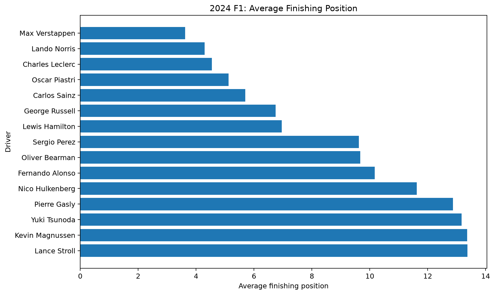
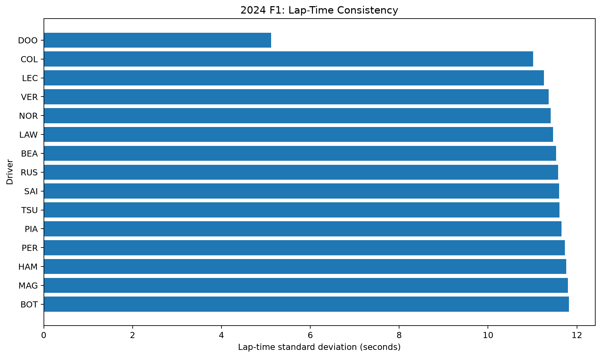
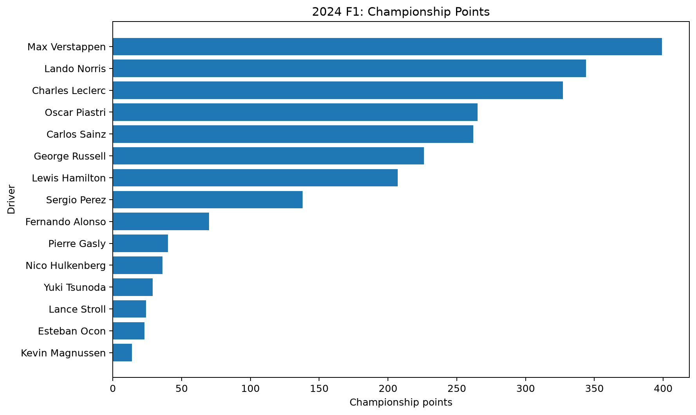
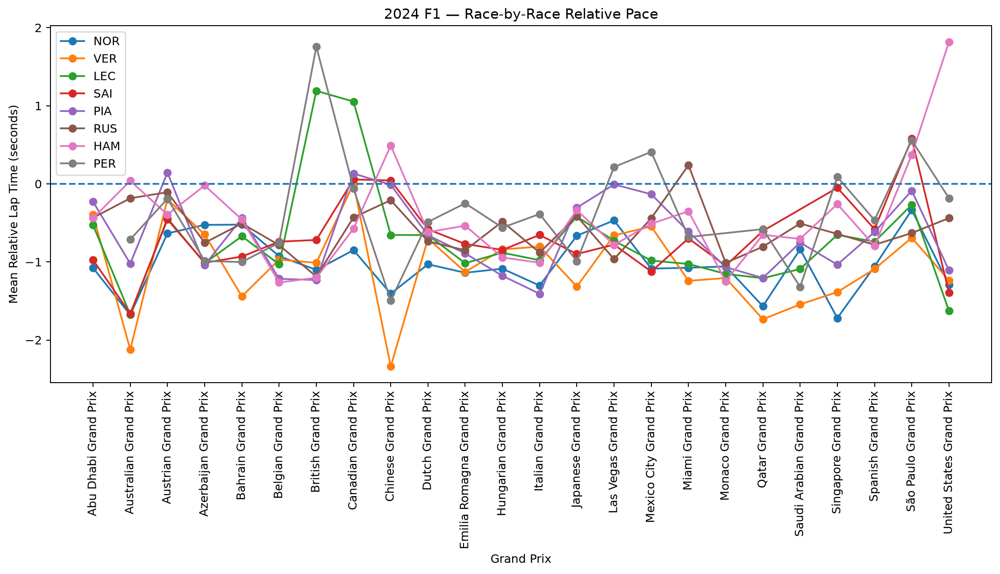
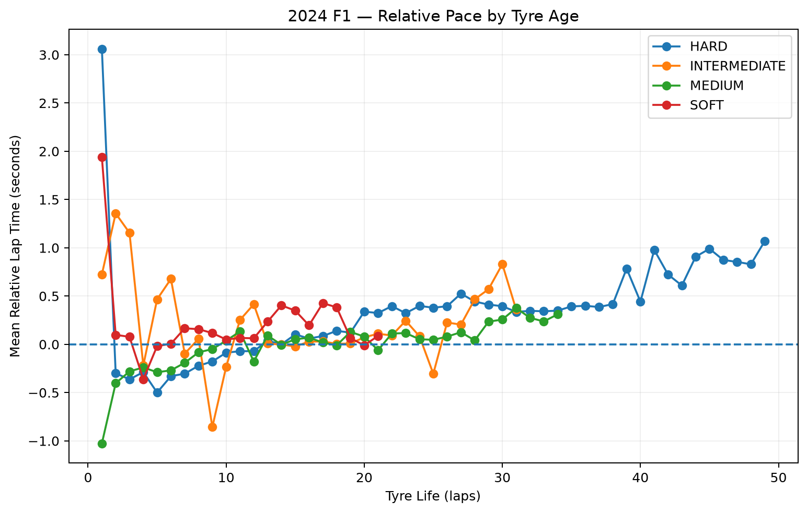
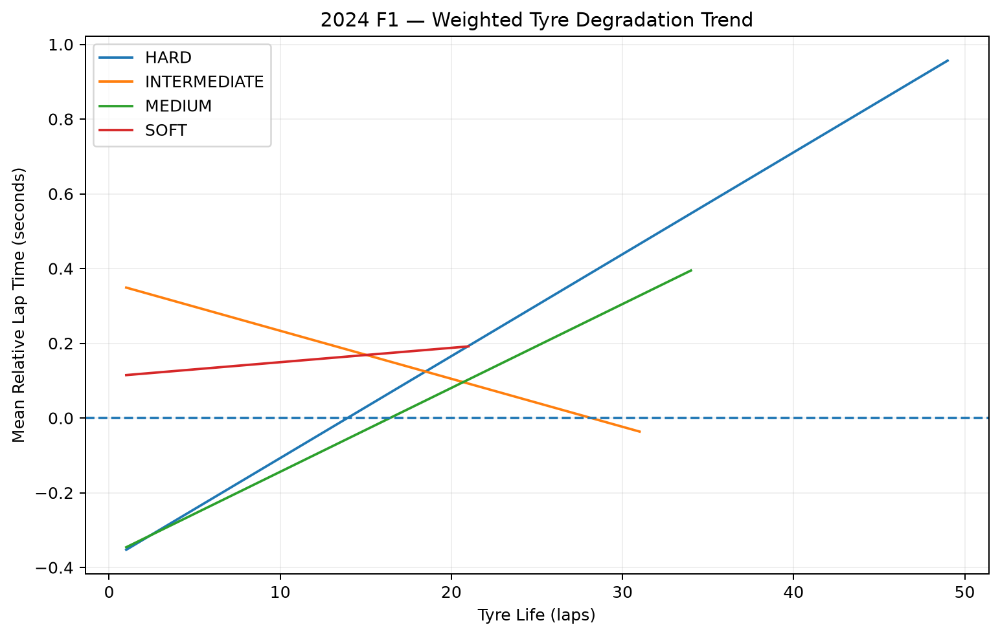

# Motorsport Race & Lap Time Data Analysis

An end-to-end Formula 1 data-analysis portfolio project built with Python, Pandas, NumPy, Matplotlib, and FastF1.

## Project Overview

This project analyzes the **2024 Formula 1 season** using race-result and lap-time data collected with FastF1.

The project focuses on:

* Driver finishing performance
* Lap-time pace
* Lap-time consistency
* Race-by-race relative pace
* Tyre usage
* Tyre-age performance
* Exploratory tyre degradation trends
* Weighted statistical analysis

The goal is to demonstrate an end-to-end data-analysis workflow, from data collection and cleaning to statistical analysis and visualization.

---

## Project Question

**How do driver pace, consistency, tyre strategy, and finishing performance vary across the 2024 Formula 1 season?**

---

## Dataset

The project collected data from all **24 race weekends of the 2024 Formula 1 season**.

### Data collected

| Dataset                     | Records |
| --------------------------- | ------: |
| Race-result records         |     479 |
| Raw lap records             |  26,604 |
| Clean lap records           |  24,399 |
| Comparable lap observations |  24,367 |

The raw data is stored locally in:

data/raw/

Files:

race_results_2024.csv
race_laps_2024.csv

---

# Featured Visualizations

The following six visualizations are the main portfolio showcase charts. They are displayed directly in this README so that visitors can see the analysis without opening the individual PNG files.

## 1. Average Finishing Position

This visualization compares drivers based on their average recorded finishing position across the 2024 season.

A lower average finishing-position value means the driver generally finished closer to the front in this dataset.



**Output:**

outputs/figures/01_average_finish.png

The corresponding processed table is:

data/processed/driver_finish_summary.csv

Important limitation: finishing position is an outcome measure affected by factors such as car performance, reliability, race strategy, incidents, penalties, pit stops, traffic, and safety-car periods.

---

## 2. Lap-Time Consistency

This visualization shows lap-time variability using the standard deviation of recorded lap times.

A lower standard deviation indicates lower variation in the recorded lap times included in the analysis.



**Output:**

outputs/figures/03_lap_time_consistency.png

The corresponding processed table is:

data/processed/driver_consistency_summary.csv

The metric should not be interpreted as a complete measure of driver consistency because lap times are affected by tyre compound, fuel load, traffic, circuit conditions, pit laps, and race circumstances.

---

## 3. Championship Points

This visualization compares the championship points recorded by drivers during the 2024 season.



**Output:**

outputs/figures/05_driver_points.png

The corresponding processed table is:

data/processed/driver_points_summary.csv

Championship points provide an important season-level outcome measure, but they should be interpreted together with other measurements rather than as a standalone explanation of driver performance.

---

## 4. Race-by-Race Relative Pace

Instead of directly comparing raw lap times between different circuits, this analysis calculates each driver's lap time relative to the other drivers on the same race and lap.

The basic concept is:

Relative Lap Time =
Driver Lap Time - Reference Lap Time

This reduces the problem caused by different circuit lengths and layouts.



**Output:**

outputs/figures/07_race_by_race_relative_pace.png

Processed outputs:

data/processed/race_driver_relative_pace.csv
data/processed/race_relative_pace_matrix.csv

Negative relative values indicate that the driver's recorded lap was faster than the reference value for that race/lap, while positive values indicate a slower lap.

This is a more useful comparison framework than simply comparing raw lap times from different circuits.

---

## 5. Controlled Tyre-Age Relative Pace

This analysis examines how relative lap pace changes as tyre age increases.

The calculation uses a **leave-one-out reference**, meaning a driver's own lap is excluded when calculating the reference median for that race/lap.



**Output:**

outputs/figures/10_controlled_tyre_age_relative_pace.png

Processed output:

data/processed/controlled_tyre_age_relative_pace.csv

The analysis provides a more controlled way to explore the relationship between tyre age and relative pace.

The results show an observable shift toward slower relative pace as tyre age increases for some compounds, particularly HARD and MEDIUM tyres.

However, this should not be interpreted as a pure physical tyre-degradation measurement because the dataset still contains factors such as:

* Fuel load
* Track evolution
* Traffic
* Weather
* Safety-car periods
* Race strategy
* Different circuit characteristics
* Different tyre compounds

---

## 6. Weighted Tyre Degradation Trend

The final showcase visualization applies a weighted linear regression to the controlled tyre-age data.

The number of recorded laps is used as the weighting factor, giving greater influence to tyre-age observations supported by more data.



**Output:**

outputs/figures/12_weighted_tyre_degradation_trend.png

Processed output:

data/processed/weighted_tyre_degradation_trend.csv

### Weighted results

| Compound     | Total laps | Slope (sec/lap) | Weighted correlation |
| ------------ | ---------: | --------------: | -------------------: |
| HARD         |     12,386 |         0.02727 |                0.820 |
| MEDIUM       |      7,898 |         0.02244 |                0.747 |
| SOFT         |      1,545 |         0.00384 |                0.058 |
| INTERMEDIATE |      1,854 |        -0.01285 |               -0.218 |

These results should be interpreted as **observational statistical associations**, not as exact physical tyre-degradation rates.

HARD and MEDIUM tyres show positive associations between tyre age and relative lap time in this dataset, while SOFT shows little linear association and INTERMEDIATE shows a weak negative association.

Wet-weather compounds are particularly difficult to interpret because changing track conditions can strongly affect lap times.

---

# Main Findings

### Finishing performance

The lowest average finishing-position values in the processed dataset were recorded by:

| Driver          | Races | Average finish | Points |
| --------------- | ----: | -------------: | -----: |
| Max Verstappen  |    24 |          3.625 |    399 |
| Lando Norris    |    24 |          4.292 |    344 |
| Charles Leclerc |    24 |          4.542 |    327 |
| Oscar Piastri   |    24 |          5.125 |    265 |
| Carlos Sainz    |    23 |          5.696 |    262 |

These values describe the dataset's measured outcomes and should not be interpreted as a complete ranking of driver ability.

### Tyre usage

Among the cleaned lap records:

| Compound     | Recorded laps |
| ------------ | ------------: |
| HARD         |        13,289 |
| MEDIUM       |         8,638 |
| INTERMEDIATE |         2,136 |
| SOFT         |         1,759 |
| WET          |            31 |

The HARD compound represents the largest number of recorded laps in the cleaned dataset.

Tyre-use counts alone cannot determine which compound was fastest or which strategy was most effective.

---

# Analysis Pipeline

The project evolved from basic descriptive analysis toward more controlled statistical analysis.

### Analysis 1 — Average finishing position

src/analyze.py

Output:

01_average_finish.png
driver_finish_summary.csv

### Analysis 2 — Average lap pace

Output:

02_average_lap_time.png
driver_lap_pace_summary.csv

Raw lap times are not directly comparable across circuits because circuits have different layouts and lengths.

### Analysis 3 — Lap-time consistency

Output:

03_lap_time_consistency.png
driver_consistency_summary.csv

### Analysis 4 — Tyre usage

Output:

04_tyre_usage.png
tyre_usage_summary.csv

### Analysis 5 — Championship points

Output:

05_driver_points.png
driver_points_summary.csv

### Analysis 6 — Relative race pace

src/analyze_relative_pace.py

Output:

06_race_relative_pace.png
driver_relative_pace_summary.csv

### Analysis 7 — Race-by-race relative pace

src/analyze_race_relative_pace.py

Outputs:

07_race_by_race_relative_pace.png
race_driver_relative_pace.csv
race_relative_pace_matrix.csv

### Analysis 8 — Tyre-age pace

src/analyze_tyre_age.py

Output:

08_tyre_age_pace.png
tyre_age_pace_summary.csv

### Analysis 9 — Tyre-age relative pace

src/analyze_tyre_age_relative_pace.py

Output:

09_tyre_age_relative_pace.png
tyre_age_relative_pace_summary.csv

### Analysis 10 — Controlled tyre-age relative pace

src/analyze_controlled_tyre_pace.py

Output:

10_controlled_tyre_age_relative_pace.png
controlled_tyre_age_relative_pace.csv

### Analysis 11 — Exploratory degradation trend

src/analyze_tyre_degradation_trend.py

Output:

11_tyre_degradation_trend.png
tyre_degradation_trend.csv

### Analysis 12 — Weighted degradation trend

src/analyze_weighted_tyre_degradation.py

Output:

12_weighted_tyre_degradation_trend.png
weighted_tyre_degradation_trend.csv

---

# Data Cleaning

The lap-time analysis includes several cleaning steps:

* Convert `LapTime` to seconds
* Remove missing lap times
* Remove missing driver/lap identifiers
* Remove extreme lap-time observations
* Exclude pit-entry and pit-exit laps where appropriate
* Normalize event-name formatting
* Require sufficient driver observations for controlled comparisons
* Use race/lap-level reference values
* Apply a leave-one-out reference for the controlled tyre-age analysis

These steps are intended to make comparisons more meaningful while keeping the analysis reproducible.

---

# Methodology

## Relative pace

For each race and lap:

Relative Lap Time =
Driver Lap Time - Reference Lap Time
```

For the controlled analysis, the reference is calculated from the other drivers in the same race/lap rather than including the driver's own observation.

This helps reduce circuit-to-circuit differences.

---

## Weighted tyre-degradation analysis

The weighted regression uses:

Tyre age → Relative lap pace
```

with the number of recorded laps used as the weighting factor.

The resulting slope describes the observed change in relative lap time associated with an additional tyre-life lap within this dataset.

It should not be interpreted as a laboratory-style physical degradation rate.

---

# Limitations

This project is an exploratory data-analysis project rather than a complete F1 performance model.

Important limitations include:

### 1. Circuit differences

Raw lap times cannot be directly compared between circuits.

### 2. Car performance

Driver results are strongly affected by the performance of the car.

### 3. Race conditions

Traffic, safety cars, weather, fuel load, penalties, and race strategy can affect lap times.

### 4. Tyre compound

Different compounds have different performance characteristics.

### 5. Tyre age

Increasing tyre age is not the only factor affecting lap time.

### 6. Sample size

Some drivers have substantially fewer observations than full-season drivers.

### 7. Statistical interpretation

The tyre-degradation models identify associations in the dataset. They do not establish causality.

### 8. FastF1 data

FastF1 is an unofficial Python package and is not associated with Formula 1.

---

# Technology Stack

* Python 3.11+
* FastF1
* Pandas
* NumPy
* Matplotlib
* Jupyter
* VS Code
* Git / GitHub

---

# Project Structure

Project_1_F1_Motorsport_Race_Analysis/

├── data/
│   ├── raw/
│   │   ├── race_results_2024.csv
│   │   └── race_laps_2024.csv
│   │
│   └── processed/
│       ├── driver_finish_summary.csv
│       ├── driver_lap_pace_summary.csv
│       ├── driver_consistency_summary.csv
│       ├── tyre_usage_summary.csv
│       ├── driver_points_summary.csv
│       ├── driver_relative_pace_summary.csv
│       ├── race_driver_relative_pace.csv
│       ├── race_relative_pace_matrix.csv
│       ├── tyre_age_pace_summary.csv
│       ├── tyre_age_relative_pace_summary.csv
│       ├── controlled_relative_pace_summary.csv
│       ├── controlled_tyre_age_relative_pace.csv
│       ├── tyre_degradation_trend.csv
│       └── weighted_tyre_degradation_trend.csv
│
├── notebooks/
│   └── F1_Race_Analysis_2024.ipynb
│
├── outputs/
│   └── figures/
│       ├── 01_average_finish.png
│       ├── 02_average_lap_time.png
│       ├── 03_lap_time_consistency.png
│       ├── 04_tyre_usage.png
│       ├── 05_driver_points.png
│       ├── 06_controlled_relative_pace.png
│       ├── 06_race_relative_pace.png
│       ├── 07_race_by_race_relative_pace.png
│       ├── 08_tyre_age_pace.png
│       ├── 09_tyre_age_relative_pace.png
│       ├── 10_controlled_tyre_age_relative_pace.png
│       ├── 11_tyre_degradation_trend.png
│       └── 12_weighted_tyre_degradation_trend.png
│
├── src/
│   ├── fetch_data.py
│   ├── analyze.py
│   ├── analyze_relative_pace.py
│   ├── analyze_race_relative_pace.py
│   ├── analyze_tyre_age.py
│   ├── analyze_tyre_age_relative_pace.py
│   ├── analyze_controlled_tyre_pace.py
│   ├── analyze_tyre_degradation_trend.py
│   └── analyze_weighted_tyre_degradation.py
│
├── .gitignore
├── analysis_report.md
├── README.md
└── requirements.txt

---

# Windows Setup

Open PowerShell in the project directory.

Create the virtual environment:

py -3.11 -m venv .venv

Activate it:

.\.venv\Scripts\Activate.ps1

Upgrade pip:

python -m pip install --upgrade pip

Install dependencies:

pip install -r requirements.txt

If PowerShell blocks activation, the project can still be run directly with:

.\.venv\Scripts\python.exe src\fetch_data.py

and:

.\.venv\Scripts\python.exe src\analyze.py

---

# Running the Project

## Download the F1 data

python src\fetch_data.py

The first run can take some time because FastF1 downloads and caches session data.

## Run the main analysis

python src\analyze.py

## Run the advanced analyses

python src\analyze_relative_pace.py

python src\analyze_race_relative_pace.py

python src\analyze_tyre_age.py

python src\analyze_tyre_age_relative_pace.py

python src\analyze_controlled_tyre_pace.py

python src\analyze_tyre_degradation_trend.py

python src\analyze_weighted_tyre_degradation.py

---

# Portfolio Skills Demonstrated

This project demonstrates practical experience with:

* Python programming
* Pandas data manipulation
* NumPy numerical analysis
* Data cleaning
* Exploratory data analysis
* Statistical analysis
* Linear regression
* Weighted regression
* Data visualization
* CSV data pipelines
* Domain-specific data analysis
* Reproducible workflows
* Git/GitHub project organization

The project also provides a foundation for moving from general data analysis toward **Computer Vision and AI**.

---

# Future Development

Possible extensions include:

* Sector-time analysis
* Telemetry comparison
* Pit-stop analysis
* Driver-vs-driver race-pace analysis
* More rigorous statistical testing
* Interactive Streamlit dashboard
* Machine-learning-based race analysis
* F1 car detection using computer vision
* F1 car tracking
* Driver/helmet detection
* Race video object detection
* Computer-vision-based motorsport analytics

The next major portfolio project can therefore move toward:

F1 Data Analysis
        ↓
Computer Vision
        ↓
Object Detection
        ↓
Object Tracking
        ↓
Motorsport AI

---

# Data Attribution

Data is retrieved through FastF1.

FastF1 is an unofficial Python package for accessing Formula 1 timing, results, telemetry, and related data.

FastF1 is not associated with Formula 1.

Formula 1, F1, Formula One, Grand Prix, and related marks belong to their respective rights holders.

---

# Quick Start

py -3.11 -m venv .venv

.\.venv\Scripts\Activate.ps1

python -m pip install --upgrade pip

pip install -r requirements.txt

python src\fetch_data.py

python src\analyze.py

python src\analyze_relative_pace.py

python src\analyze_race_relative_pace.py

python src\analyze_tyre_age.py

python src\analyze_tyre_age_relative_pace.py

python src\analyze_controlled_tyre_pace.py

python src\analyze_tyre_degradation_trend.py

python src\analyze_weighted_tyre_degradation.py

---

# Final Takeaway

This project started as a basic Formula 1 data-analysis exercise and evolved into a reproducible analysis pipeline covering race results, lap pace, relative pace, tyre age, and exploratory statistical modelling.

The six featured visualizations provide a concise view of the project's progression:

Race outcomes
      ↓
Lap-time consistency
      ↓
Championship points
      ↓
Race-by-race relative pace
      ↓
Controlled tyre-age analysis
      ↓
Weighted statistical modelling

The project demonstrates not only the ability to work with Python data-analysis tools, but also the ability to identify limitations in raw data, improve the methodology, and communicate analytical results clearly.
